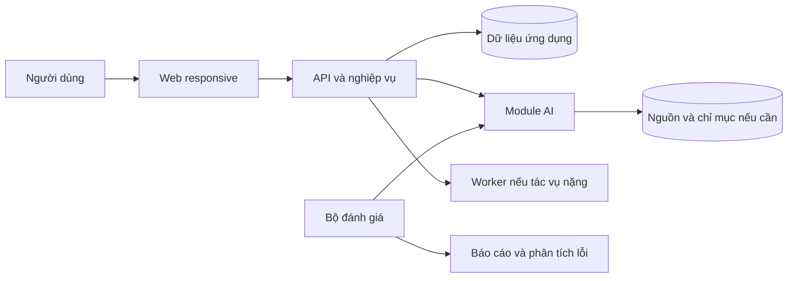

# Đề xuất đề tài NCKH ứng dụng: web/app có AI dành cho Lê Việt Thành

Ngày lập: **08/10/2026**. Cơ sở lựa chọn: các project trong `/mnt/Data1/LeVietThanh1412-Product/` và tài liệu trong thư mục `đề tài/`.

**Đề xuất ưu tiên:** nếu muốn tận dụng code cũ, có người dùng và có thực nghiệm để bảo vệ, chọn **D01 — Phân tích phản hồi tiếng Việt**, **D02 — Hỏi đáp tài liệu theo phiên bản**, hoặc **D03 — Tìm đề tài và giảng viên hướng dẫn**. Nếu muốn demo nổi bật và đi theo thế mạnh 3D, chọn **D09 — Bảo tàng/laboratory 3D trên web**.

Tài liệu này đề xuất **12 đề tài chi tiết và 3 hướng dự phòng**. Không giới hạn ý tưởng theo encoder/decoder.

## 1. Phạm vi khảo sát và điều rút ra từ project hiện có

Đã khảo sát cấu trúc của **50 thư mục project cấp một**, đọc README/tài liệu mô tả ở những nơi có tài liệu, xem cấu trúc source và một số module tiêu biểu của các project liên quan trực tiếp. Đây là khảo sát để chọn đề tài; chưa chạy lại hoặc kiểm định chất lượng toàn bộ project. Thư viện tải về, môi trường ảo, binary, model lớn và dữ liệu cá nhân không được dùng làm căn cứ đánh giá năng lực. Một repository nằm trong thư mục của bạn có thể là bài tập, dự án nhóm hoặc mã tham khảo; không mặc định mọi mã nguồn đều do bạn tự viết.

### 1.1. Những nền tảng có thể tận dụng

| Nhóm | Bằng chứng trong project | Hướng tận dụng |
|---|---|---|
| RAG và hệ thống tài liệu | `rag-chatbot-uet`: API, worker, chunking, keyword/semantic retrieval, rank fusion, reranker; `share-llms-local` có thử nghiệm RAG | Hỏi đáp có dẫn nguồn, tra cứu nghiên cứu, trợ lý học tập |
| NLP tiếng Việt | `BTL-AIT2004-2-Peguin`: NB, MLP, LSTM, PhoBERT, ensemble, API, extension, script đánh giá | Phân tích phản hồi, phân loại nội dung, hỗ trợ xử lý ticket |
| Web/app có nghiệp vụ | `CompanyWeb`, `VietPhucRemix`, hệ thống điểm danh, Java web, quản lý thư viện | Làm được sản phẩm có tài khoản, dữ liệu, quản trị và quy trình |
| Computer vision | `ai-detection-from-sratch`, `dl-pj`, điểm danh khuôn mặt | Tìm kiếm bằng ảnh, số hóa giấy tờ, đánh giá mô hình trên ảnh thực |
| Tương tác camera/3D | `AI-Virtual-Mouse`, `ai-vision-controller`, `Planet`, `wondersnap-main`, `V-tuber` | Bài học 3D điều khiển bằng cử chỉ, giao diện tương tác |
| Dựng hình và tối ưu 3D | `Race-2026`, `BTL_DuAn`, `vdt-2026-3d-gaussian-splatting`, `3D_Gaussian_Platting` | Thư viện mô hình 3D, dựng cảnh, tối ưu hiển thị web |
| Dữ liệu và phân tích | Airbnb, `scraping-etsy-master`, `QuanLiTaiChinh` | Dashboard có mô hình dự đoán/phân loại, báo cáo có bằng chứng |
| Tối ưu và mô phỏng | `cleaning-robot-rl`, `flappy-bird-neat`, bài tập C++ trong `vdt` | So sánh thuật toán lập lịch, tìm đường, chính sách điều khiển |

**Nhận xét cá nhân hóa:** lợi thế đáng tận dụng của bạn là nối mô hình AI với sản phẩm và hạ tầng. Vì vậy, đề tài nên có một bài toán AI vừa đủ sâu, đi cùng luồng người dùng hoàn chỉnh và một bộ đánh giá rõ ràng. Không cần bắt đầu bằng việc tự huấn luyện một mô hình lớn.

Một số phát hiện ảnh hưởng trực tiếp đến cách chọn đề tài:

- RAG hiện có đã chứa các thành phần hybrid retrieval và reranking. D02 nên phát triển quản lý phiên bản, kiểm chứng nguồn và đánh giá khả năng từ chối, thay vì chỉ thêm một giao diện chat.
- Trong `rag-chatbot-uet/backend-api/app/generation/orchestrator.py`, biến ngưỡng được tính nhưng bộ lọc đang dùng giá trị cố định `>= -10.0`, đồng thời có fallback sang toàn bộ tài liệu truy xuất. Đây là một điểm cụ thể có thể nghiên cứu cải thiện và đo lại; chưa thể kết luận mức độ ảnh hưởng khi chưa chạy benchmark.
- `VietPhucRemix` đã có bộ kiểm tra quy tắc văn hóa, tư vấn AI và các bài kiểm tra. D05 cần bổ sung tri thức có nguồn và thực nghiệm, tránh nộp lại cùng chức năng dưới tên mới.
- `timetable-manager` có luồng upload/Excel và Flask, nhưng module lưu dữ liệu đang có placeholder. D04 có thể kế thừa ý tưởng nhập dữ liệu, còn bộ lập lịch và nghiệp vụ cần xây mới.
- `BTL_XLNNTN/main.py` hiện trống; `BTL_DataMining` và thư mục `Encode_Decode` cấp một hiện trống. Không tính các thư mục này là nền tảng đã hoàn thiện.
- README của `Race-2026` nhắc RTX 4050 6 GB. Tài liệu này không coi đó là cấu hình máy đã được xác minh; mọi đề xuất ưu tiên phương án ít phụ thuộc GPU và cho phép đo tài nguyên thực tế sau.

### 1.2. Danh sách NCKH của bạn cho thấy điều gì?

Đã đọc:

- [Bảng tổng hợp đề tài của khoa](<Bảng DS đề tài của khoa CNTT - đã chia tiểu ban.xlsx>): **36 tên đề tài**, ghi năm học **2023–2024**, Hội nghị lần thứ 37, Trường Đại học Thủy lợi.
- [Tiểu ban 1](<Tiểu ban 1.pdf>), [Tiểu ban 2](<Tiểu ban 2.pdf>), [Tiểu ban 3](<Tiểu ban 3.pdf>), [Tiểu ban 4](<Tiểu ban 4.pdf>): **44 lượt báo cáo**, ghi Hội nghị lần thứ 38.

Không gộp hai nguồn thành một danh sách của cùng kỳ: tên hội nghị và các đề tài khác nhau. Dòng ngày tổ chức trong PDF còn có dấu hiệu không nhất quán, nên không dùng để suy ra lịch hiện tại.

Các ví dụ sát mong muốn “làm web/app có AI”:

| Nguồn | Ví dụ đã có trong tài liệu | Liên hệ với đề xuất |
|---|---|---|
| XLSX, đề tài 1 | Phần mềm hỗ trợ người không biết lập trình sử dụng phương pháp học máy | Sản phẩm phần mềm có AI là một hướng đã xuất hiện |
| XLSX, đề tài 20–21 | Đánh giá mức độ hài lòng; phân tích bình luận cho du lịch | D01 cần chọn miền và đầu ra sâu hơn phân loại cảm xúc chung |
| XLSX, đề tài 30 | Mô phỏng, tái tạo không gian 3D hỗ trợ học tập | D09 có cơ sở liên hệ với đề tài ứng dụng 3D |
| PDF tiểu ban 1 | Thực đơn điện tử, quản lý sự kiện, hỗ trợ giảng dạy | Có các đề tài thiên về ứng dụng và hệ thống thông tin |
| PDF tiểu ban 2 | OCR học bạ; chatbot đa phương tiện cố vấn học tập; thư viện Bibliograph | D02, D03, D06 có hướng tham khảo, cũng cần nêu phần phát triển thêm |
| PDF tiểu ban 3 | Website quản lý đề tài NCKH | D03 nên tập trung khả năng tìm kiếm và gợi ý, không chỉ CRUD |
| PDF tiểu ban 4 | Gợi ý sản phẩm; tìm chuyên gia/GVHD; nhận dạng khuôn mặt chấm công | D03, D05 và D14 có tiền lệ về chủ đề |

**Có cơ sở để đề xuất một đề tài ứng dụng**, nhưng danh sách hội nghị cũ của trường khác không xác nhận yêu cầu hiện tại tại UET/trường bạn. Khi đăng ký, cần đối chiếu mẫu đề cương và yêu cầu của GVHD. Trong tài liệu này, “đóng góp” là sản phẩm, dữ liệu, phương pháp tích hợp và thực nghiệm dự kiến; không khẳng định đã có tính mới ở phạm vi toàn ngành.

## 2. Chọn đề tài theo mục tiêu của bạn

### 2.1. Giả định về nguồn lực

- Nhóm **1–3 người**, thực hiện khoảng **12–16 tuần**, mỗi người **10–15 giờ/tuần**. Ước lượng dưới đây có thể thay đổi theo mức hoàn thiện của code cũ và việc tiếp cận dữ liệu.
- Ưu tiên web responsive/PWA để dùng trên điện thoại; app native là mở rộng sau.
- Có thể dùng mô hình có sẵn và API, nhưng vẫn tự xây nghiệp vụ, dữ liệu và đánh giá. Không mặc định có ngân sách cloud/GPU.
- MVP = phiên bản nhỏ nhất chạy trọn một luồng hữu ích; “phần nghiên cứu” = câu hỏi có thể kiểm tra bằng thực nghiệm.
- Mọi số lượng dữ liệu và ngưỡng nghiệm thu trong các đề tài là **kế hoạch/mục tiêu**, không phải kết quả đã đạt được.

### 2.2. Bảng so sánh

Điểm 1–5 là nhận định định tính của người viết theo khảo sát hiện tại; **5 là thuận lợi hơn**. Không phải kết quả benchmark hay dự báo giải thưởng. Cột demo đánh giá khả năng thể hiện giá trị trong vài phút.

| Mã | Đề tài | Tận dụng code | Dữ liệu dễ lấy | Vừa sức | Demo | Thực nghiệm rõ | Thời gian MVP ước lượng |
|---|---|---:|---:|---:|---:|---:|---|
| D01 | Phân tích phản hồi tiếng Việt theo khía cạnh | 5 | 4 | 5 | 4 | 5 | 5–7 tuần |
| D02 | Hỏi đáp tài liệu theo phiên bản và kiểm chứng nguồn | 5 | 5 | 4 | 4 | 5 | 6–8 tuần |
| D03 | Tìm đề tài/GVHD dựa trên hồ sơ dự án | 4 | 4 | 4 | 4 | 4 | 6–8 tuần |
| D04 | Lập kế hoạch học tập theo ràng buộc | 3 | 4 | 4 | 4 | 5 | 6–8 tuần |
| D05 | Việt phục có tư vấn dựa trên tri thức và quy tắc | 5 | 3 | 4 | 5 | 4 | 5–7 tuần |
| D06 | Trợ lý ôn tập có bằng chứng từ tài liệu môn học | 4 | 4 | 4 | 4 | 4 | 6–8 tuần |
| D07 | Sổ chi tiêu với phân loại giao dịch và OCR | 4 | 3 | 4 | 4 | 4 | 6–8 tuần |
| D08 | Trợ lý báo giá vật liệu xây dựng | 5 | 4 | 5 | 4 | 4 | 5–7 tuần |
| D09 | Bảo tàng/laboratory 3D có hỏi đáp theo vật thể | 5 | 3 | 2 | 5 | 5 | 8–10 tuần |
| D10 | Tìm đồ thất lạc bằng ảnh và mô tả | 4 | 3 | 4 | 5 | 5 | 6–8 tuần |
| D11 | Bài học 3D điều khiển bằng cử chỉ | 5 | 4 | 4 | 5 | 4 | 5–7 tuần |
| D12 | Phân tích homestay và review có giải thích | 4 | 4 | 4 | 4 | 4 | 6–8 tuần |

Thời gian MVP chưa bao gồm toàn bộ thu thập/gán nhãn bổ sung, thử nghiệm người dùng và hoàn thiện báo cáo.

**Chọn nhanh:**

- Muốn dễ đi đến sản phẩm và báo cáo cân đối: **D01**.
- Muốn phát triển tiếp hướng AI/backend đang có: **D02**.
- Muốn làm thứ có thể tự dùng để chọn đề tài, kết nối nhóm và tìm GVHD: **D03**.
- Có doanh nghiệp nhỏ cho dùng dữ liệu và thử nghiệm: **D08**.
- Muốn đi theo CV/3D và chấp nhận nhiều việc kỹ thuật hơn: **D09**.
- Thích sản phẩm văn hóa, giao diện và trải nghiệm người dùng: **D05**.

## 3. Mười hai đề tài chi tiết

### D01. Hệ thống phân tích phản hồi tiếng Việt theo khía cạnh và hỗ trợ xử lý vấn đề

**Tên đăng ký:** “Xây dựng hệ thống phân tích phản hồi tiếng Việt theo khía cạnh kết hợp mô hình ngôn ngữ và dashboard hỗ trợ cải tiến dịch vụ”.

**Bài toán và người dùng:** một đơn vị có hàng trăm phản hồi nhưng chưa biết vấn đề nào lặp lại. Ví dụ: “Thầy giảng dễ hiểu nhưng phòng nóng và lịch học hay đổi” chứa nhiều khía cạnh với cảm xúc khác nhau. Người dùng là cán bộ phụ trách khảo sát, CLB, bộ phận dịch vụ hoặc chủ cửa hàng. Chọn **một miền** để làm MVP: phản hồi môn học hoặc phản hồi cửa hàng.

**Luồng sản phẩm:** nhập CSV → chuẩn hóa/ẩn thông tin định danh → phân tích → dashboard khía cạnh/cảm xúc → xem các câu làm bằng chứng → người phụ trách tạo và cập nhật ticket → báo cáo trước/sau một đợt cải tiến.

**MVP:** nhập dữ liệu, quản lý đợt khảo sát, 4–6 nhóm khía cạnh, cảm xúc cho từng khía cạnh, lọc theo đợt, dẫn về câu gốc, sửa nhãn, xuất báo cáo. Chưa cần crawl mạng xã hội hoặc trả lời tự động thay nhân viên.

**AI và phần phát triển thêm:** kế thừa `BTL-AIT2004-2-Peguin`, chuyển từ cảm xúc toàn câu sang cặp **khía cạnh–cảm xúc**, bổ sung gom nhóm vấn đề và tóm tắt có dẫn chứng. Có thể bắt đầu với classifier đa nhãn và classifier cảm xúc; LLM chỉ hỗ trợ trích xuất/tóm tắt. PhoBERT là một lựa chọn phù hợp để tận dụng code hiện có; thực hiện tiền xử lý theo hướng dẫn của [VinAI/PhoBERT](https://github.com/VinAIResearch/PhoBERT).

**Dữ liệu:** dùng UIT-VSFC cho benchmark cảm xúc/chủ đề ban đầu, theo [nguồn công bố của tác giả](https://github.com/kietnv/uit-vsfc). Bộ này không tự cung cấp đầy đủ nhãn khía cạnh–cảm xúc cần cho MVP. Dự kiến tự gán nhãn **600–1.200 phản hồi** thuộc miền đã chọn, trong đó **150–250 mẫu** được hai người gán độc lập. Dữ liệu giả chỉ dùng kiểm tra UI; test cuối dùng phản hồi thật đã được phép sử dụng và loại định danh.

**Câu hỏi thực nghiệm:** thêm nhãn khía cạnh và nhóm vấn đề có giúp người dùng tìm đúng vấn đề cần xử lý nhanh hơn cách chỉ đọc cảm xúc toàn câu không?

**Đối chứng và đo lường:** TF-IDF + Logistic Regression → PhoBERT → mô hình khía cạnh–cảm xúc. Đo macro-F1 cảm xúc, F1 đa nhãn khía cạnh, F1 cặp khía cạnh–cảm xúc; kiểm tra các câu tóm tắt có được câu nguồn hỗ trợ. Chia dữ liệu theo đợt/lớp/cửa hàng, loại câu gần trùng giữa train/test. Thử 10–15 người với cùng nhiệm vụ xác định ba vấn đề phổ biến; đảo thứ tự giao diện để giảm hiệu ứng học.

**Demo 3 phút:** nạp một đợt phản hồi → mở biểu đồ “cơ sở vật chất tiêu cực” → bấm xem câu nguồn → sửa một nhãn → tạo ticket → xuất báo cáo. Cần cho thấy một câu nhiều khía cạnh và một câu mỉa mai bị hệ thống đánh dấu cần kiểm tra.

**Rủi ro/cắt phạm vi:** gán nhãn tốn công, cảm xúc mỉa mai khó. Nếu thiếu dữ liệu, giữ 4 nhóm khía cạnh, bỏ gom cụm tự động. **Ước lượng:** MVP 5–7 tuần; bản có thực nghiệm 12–14 tuần. **Stack gợi ý:** FastAPI, React/Vue, PostgreSQL, worker inference, mô hình NLP hiện có.

### D02. Hệ thống hỏi đáp tài liệu có quản lý phiên bản và kiểm chứng nguồn

**Tên đăng ký:** “Xây dựng hệ thống hỏi đáp tài liệu tiếng Việt có quản lý phiên bản, truy xuất kết hợp và đánh giá độ tin cậy của câu trả lời”.

**Bài toán:** khi quy định thay đổi, chatbot có thể trộn bản cũ/bản mới hoặc trả lời dù nguồn không đủ. Người dùng là sinh viên và bộ phận quản trị tài liệu. MVP chỉ chọn **một tập tài liệu**: quy chế và thông báo học tập, hoặc SOP nội bộ của một đơn vị.

**Luồng sản phẩm:** admin đưa tài liệu lên → nhập phạm vi áp dụng/ngày hiệu lực/quan hệ thay thế → người dùng chọn thời điểm → hỏi → hệ thống trả lời kèm trang/điều/phiên bản → bấm mở đoạn nguồn; nếu không đủ nguồn, hiển thị điều còn thiếu.

**MVP:** ingest PDF text, metadata phiên bản, lọc hiệu lực, hỏi đáp có nguồn, xem hai phiên bản khác nhau, đánh dấu câu trả lời cần rà soát, quản trị nguồn. OCR scan và tự phát hiện mọi quan hệ thay thế là phần mở rộng. Trong MVP, metadata hiệu lực được người quản trị xác nhận.

**Kế thừa:** `rag-chatbot-uet` và `share-llms-local`. Tái dùng ingestion, keyword/semantic search, rank fusion; kiểm tra lại việc truyền metadata đến generation. Phần mới là retrieval theo thời điểm, xử lý nguồn xung đột và quyết định từ chối. BGE-M3 hỗ trợ retrieval đa ngôn ngữ và các dạng biểu diễn khác nhau; chọn cấu hình theo [model card của BAAI](https://huggingface.co/BAAI/bge-m3), rồi đo trên tiếng Việt của miền này.

**Dữ liệu:** **30–80 tài liệu**, tối thiểu **8–15 cặp phiên bản**, **200–300 câu hỏi**. Chia nhóm: câu trả lời được; câu không có đáp án; câu phải chọn bản mới; câu hỏi về thời điểm cũ; nguồn xung đột. Gán đáp án và đoạn nguồn chuẩn trước khi chạy mô hình. Để có đủ tình huống, có thể tạo tài liệu phiên bản giả lập nhưng phải ghi riêng với tài liệu thực; không trình bày giả lập như quy định của trường.

**Câu hỏi thực nghiệm:** retrieval có bộ lọc phiên bản và cơ chế từ chối có giảm câu trả lời dùng nguồn sai thời điểm hoặc không được nguồn hỗ trợ không?

**Đối chứng:** semantic RAG không lọc phiên bản → hybrid + rerank → thêm lọc hiệu lực → thêm kiểm tra nguồn/từ chối. Đo Recall@5 của nguồn chuẩn, tỷ lệ dùng sai phiên bản, độ đúng của citation và câu trả lời, precision/recall khi từ chối; báo cáo cả tỷ lệ câu được trả lời để tránh “cứ từ chối là đạt điểm cao”. Ngưỡng từ chối được chọn bằng validation, không dùng test để chỉnh ngưỡng. Không diễn giải similarity score thành xác suất đúng nếu chưa hiệu chuẩn.

**Demo:** cùng câu hỏi ở hai mốc thời gian → hai kết quả có nguồn tương ứng; một câu thiếu dữ liệu → hỏi lại/từ chối; một tài liệu hết hiệu lực → hệ thống giải thích vì sao không dùng. Hệ thống hỗ trợ tra cứu, không đại diện cơ quan ban hành quy định.

**Rủi ro/cắt phạm vi:** thiếu cặp tài liệu phiên bản, PDF lỗi, metadata không rõ. Thu nhỏ vào một loại quy chế; admin xác nhận quan hệ thay thế. **Ước lượng:** MVP 6–8 tuần; hoàn thiện 12–16 tuần. **Stack:** kế thừa FastAPI/worker/Qdrant và frontend hiện có; chỉ giữ những service cần cho MVP.

### D03. Nền tảng tìm đề tài và GVHD dựa trên hồ sơ dự án, có giải thích độ phù hợp

**Tên đăng ký:** “Xây dựng nền tảng hỗ trợ lựa chọn đề tài và giảng viên hướng dẫn dựa trên truy xuất ngữ nghĩa và hồ sơ năng lực sinh viên”.

**Bài toán:** sinh viên có project nhưng khó nối chúng với đề tài vừa sức và người hướng dẫn phù hợp. Đề tài này xuất phát trực tiếp từ nhu cầu hiện tại của bạn. Người dùng là sinh viên, GVHD và người quản lý danh mục đề tài.

**Luồng sản phẩm:** sinh viên nhập kỹ năng và README project → chọn quỹ thời gian/dữ liệu/thiết bị → nhận danh sách đề tài phù hợp → xem bằng chứng từ project và hồ sơ GVHD → đánh dấu quan tâm → xuất đề cương nháp. Không tự gửi lời mời cho giảng viên.

**MVP:** danh mục đề tài/GVHD, nhập hồ sơ thủ công hoặc README, bộ lọc ràng buộc, top-5 gợi ý có giải thích, bookmark, đề cương theo mẫu. Không cần tích hợp GitHub OAuth hay đọc toàn bộ repository trong phiên bản đầu.

**AI:** trích xuất kỹ năng từ README với schema cố định; hybrid search trên mô tả đề tài; reranking theo mức phù hợp và ràng buộc; sinh giải thích từ các đoạn bằng chứng. Gợi ý người hướng dẫn chỉ theo lĩnh vực và thông tin công bố; **khả năng nhận thêm sinh viên** phải do giảng viên/admin cập nhật, không suy ra bằng AI.

**Kế thừa:** RAG, project portfolio `LeVietThanh1412.github.io`, kỹ năng CRUD từ các web hiện có. Khác với website quản lý đề tài trong PDF: tập trung vào matching có bằng chứng. Khác với ứng dụng tìm GVHD trong PDF: bổ sung hồ sơ project, ràng buộc nguồn lực và đánh giá xếp hạng; mức độ khác biệt cần khảo sát sản phẩm/bài báo liên quan khi viết đề cương chính thức.

**Dữ liệu:** các đề tài trong XLSX/PDF là danh mục khởi đầu để thử chức năng; tránh gán chúng cho UET. Bổ sung **100–200 mô tả đề tài**, **20–40 hồ sơ giảng viên công khai**, **20–30 hồ sơ sinh viên tự nguyện/giả lập có ghi rõ**. Không tái công bố danh sách tên sinh viên trong tài liệu gốc nếu không cần. Tạo **100–150 cặp hồ sơ–đề tài** được ít nhất hai người chấm độ phù hợp; cần GVHD hỗ trợ để có nhãn đủ đáng tin.

**Thực nghiệm:** so sánh tìm bằng từ khóa, tìm embedding, hybrid + ràng buộc. Đo nDCG@5/Recall@5 trên danh sách đã được chấm, tỷ lệ vi phạm ràng buộc, tỷ lệ giải thích được bằng chứng hỗ trợ. Thử người dùng với nhiệm vụ chọn và giải thích một đề tài trong thời gian giới hạn; không dùng “số người bấm thích” làm nhãn năng lực thực tế.

**Demo:** hồ sơ có RAG + NLP + GPU hạn chế → top-5 đề tài → mở “vì sao hợp” → đổi thời gian từ 16 xuống 8 tuần → thứ hạng và phạm vi thay đổi → xuất đề cương.

**Rủi ro/cắt phạm vi:** danh mục nhỏ, tính phù hợp chủ quan, thiếu GVHD chấm. Nếu không có người chấm chuyên môn, chuyển mục tiêu sang cải thiện tìm kiếm danh mục và công khai giới hạn đánh giá. **Ước lượng:** MVP 6–8 tuần; bản đầy đủ 12–16 tuần. **Stack:** FastAPI, PostgreSQL, vector index, React/Vue.

### D04. Trợ lý lập kế hoạch học tập kết hợp AI và tối ưu ràng buộc

**Tên đăng ký:** “Xây dựng hệ thống hỗ trợ lập kế hoạch học tập cá nhân hóa kết hợp xử lý ngôn ngữ tự nhiên và tối ưu hóa ràng buộc”.

**Bài toán:** chọn học phần cần thỏa tiên quyết, số tín chỉ, lịch không trùng và giờ làm thêm. Người dùng nhập “không học tối thứ ba, ưu tiên hoàn thành nhóm môn nền tảng” rồi nhận các phương án hợp lệ.

**MVP và luồng:** nhập chương trình đào tạo/lịch lớp dạng CSV → sinh viên xác nhận môn đã học → ghi ràng buộc → xem 2–3 phương án → kéo đổi và kiểm tra lại → xuất lịch. Giới hạn một chương trình, một học kỳ và tối đa khoảng 50 học phần; không dự đoán GPA.

**AI:** chuyển yêu cầu tự nhiên thành ràng buộc có cấu trúc và giải thích phương án. Bộ solver quyết định tính hợp lệ; LLM không tự kết luận đã đủ điều kiện tốt nghiệp. Có thể dùng CP-SAT với nền tảng [OR-Tools cho scheduling](https://developers.google.com/optimization/scheduling). Đây là kết hợp NLP với tối ưu hóa; solver không được mô tả là mô hình học máy.

**Kế thừa:** `timetable-manager` cho nhập dữ liệu/giao diện và RAG cho giải thích nguồn tiên quyết. Cần xây mới dữ liệu môn, lớp mở, ràng buộc và solver.

**Dữ liệu:** thông tin chương trình đào tạo có nguồn và được kiểm tra; lịch lớp tự xây hoặc được phép sử dụng. Tạo **100–200 tình huống**, gồm ràng buộc vô nghiệm, môn thay thế, tiên quyết và yêu cầu ngôn ngữ mơ hồ. Nếu lịch thật không lấy được, đánh giá solver trên lịch giả lập, ghi rõ giới hạn triển khai.

**Thực nghiệm:** so sánh chọn tham lam với solver; tách đánh giá NLP khỏi solver. Đo độ đúng chuyển ràng buộc, tỷ lệ phương án hợp lệ theo bộ kiểm tra độc lập, giá trị hàm mục tiêu và thời gian chạy. Với bài toán nhỏ, đối chiếu vét cạn; với bài toán lớn, báo trạng thái solver và khoảng tối ưu nếu có. Khi vô nghiệm, giải thích nhóm ràng buộc xung đột theo kiểm tra thực tế, không để LLM bịa.

**Demo:** đặt giờ làm thêm → nhận lịch → thêm điều kiện khiến vô nghiệm → bỏ một điều kiện → có phương án mới.

**Rủi ro/cắt phạm vi:** dữ liệu đào tạo có ngoại lệ. Chỉ làm một ngành, admin duyệt quy tắc. **Ước lượng:** 6–8 tuần MVP, 12–14 tuần hoàn thiện. **Stack:** Flask/FastAPI, PostgreSQL, OR-Tools, frontend lịch.

### D05. Việt phục Remix với tư vấn có nguồn và kiểm tra bối cảnh văn hóa

**Tên đăng ký:** “Phát triển ứng dụng tư vấn Việt phục theo bối cảnh sử dụng dựa trên cơ sở tri thức và bộ kiểm tra quy tắc”.

**Bài toán:** người dùng muốn phối Việt phục cho lễ tốt nghiệp, chụp ảnh hoặc sự kiện nhưng khó phân biệt gợi ý sáng tạo với thông tin lịch sử có căn cứ.

**Kế thừa:** `VietPhucRemix` đã có React, giao diện phối đồ, tư vấn AI, quy tắc văn hóa và test. Đề tài mới cần tập trung vào **chất lượng tri thức, dẫn nguồn và đánh giá quy tắc**.

**MVP và luồng:** chọn dịp/phong cách → nhận phối đồ từ catalog → xem nguồn cho thông tin văn hóa → nhận cảnh báo theo quy tắc đã được xác nhận → chỉnh trang phục → lưu lookbook. Không cần sinh ảnh thử đồ, đo cơ thể hay dựng avatar cá nhân.

**AI:** RAG trên tri thức trang phục; sinh giải thích và gợi ý trong catalog. Rule engine kiểm tra cấu hình; mỗi quy tắc có nguồn, phạm vi, người duyệt và mức chắc chắn. Khi chưa có quy tắc, hiển thị “chưa phát hiện xung đột trong bộ quy tắc hiện có”, không khẳng định đã đúng mọi truyền thống.

**Dữ liệu:** **50–100 mục catalog/tri thức**, **20–40 quy tắc có căn cứ**, **100–150 tình huống phối đồ**. Dùng ảnh tự tạo hoặc được phép dùng. Cần một người có chuyên môn văn hóa/thời trang hoặc GVHD hỗ trợ rà soát; ý kiến cộng đồng không tự trở thành sự thật lịch sử.

**Thực nghiệm:** gợi ý bằng prompt đơn → thêm RAG → thêm rule checker. Đo tỷ lệ thông tin được nguồn hỗ trợ, tỷ lệ vi phạm quy tắc trong tập kiểm tra, tỷ lệ gợi ý thực hiện được bằng catalog và đánh giá mức hữu ích. Chấm rubric rõ ràng; phân biệt độ đúng văn hóa với mức người dùng thích màu sắc.

**Demo:** tạo outfit cho một sự kiện → hệ thống cảnh báo một quy tắc có nguồn → chỉnh cấu hình → lưu và chia sẻ lookbook.

**Rủi ro/cắt phạm vi:** tri thức có nhiều cách diễn giải; không đủ chuyên gia duyệt. Thu nhỏ vào một dòng trang phục/bối cảnh, bỏ tuyên bố “xác thực văn hóa” rộng. **Ước lượng:** 5–7 tuần MVP, 10–14 tuần hoàn thiện. **Stack:** giữ React/TypeScript và backend hiện có, thêm kho tri thức và đánh giá.

### D06. Trợ lý ôn tập từ tài liệu môn học với câu hỏi có bằng chứng

**Tên đăng ký:** “Xây dựng ứng dụng hỗ trợ ôn tập từ tài liệu môn học bằng truy xuất tri thức và sinh câu hỏi có kiểm chứng”.

**Bài toán:** sinh viên cần ôn từ slide/PDF cụ thể; câu hỏi sinh tự do có thể nằm ngoài nội dung môn hoặc có đáp án mơ hồ.

**Luồng/MVP:** upload tài liệu một môn → chia theo bài → đọc tóm tắt có nguồn → làm quiz → xem giải thích và trang nguồn → đánh dấu phần chưa hiểu. Hỗ trợ PDF text trước; ảnh sơ đồ và OCR là mở rộng. Chỉ làm một môn bạn có tài liệu và hiểu đủ để kiểm tra đáp án.

**AI:** retrieval theo chương, sinh câu hỏi/đáp án có structured output, bộ kiểm tra đáp án và bằng chứng. Cá nhân hóa ban đầu bằng lịch sử trả lời và quy tắc ôn tập; chỉ gọi là thích nghi bằng học máy nếu thực sự huấn luyện/đánh giá một mô hình riêng.

**Kế thừa:** `rag-chatbot-uet`, tài liệu/prompt trong `image-processing-analysis-main`, kinh nghiệm xử lý báo cáo/slide. Phần mới là ngân hàng câu hỏi có kiểm chứng và đánh giá học tập, thay vì chỉ sinh slide đẹp.

**Dữ liệu:** **8–15 chương/bài**, **150–250 câu hỏi** được duyệt đáp án và nguồn. Chỉ dùng tài liệu được phép xử lý/chia sẻ. Tạo tập kiểm tra câu hỏi ngoài tài liệu, ký hiệu công thức và câu có nhiều đáp án hợp lý.

**Thực nghiệm:** prompt không retrieval → có retrieval → có retrieval + kiểm tra. Chấm tính đúng, mức hỗ trợ bởi nguồn, độ mơ hồ và độ bao phủ bài. Thử 10–20 sinh viên qua hai bộ câu hỏi tương đương, đảo thứ tự điều kiện; coi kết quả là khảo sát ban đầu, không suy ra tác động giáo dục dài hạn.

**Demo:** sinh 5 câu về một chương → trả lời sai → mở giải thích có trang nguồn → một yêu cầu ngoài chương bị chặn hoặc chuyển sang bài phù hợp.

**Rủi ro/cắt phạm vi:** chấm câu hỏi tốn thời gian; PDF công thức khó. Chọn một môn, quiz trắc nghiệm trước, bỏ chấm tự luận. **Ước lượng:** 6–8 tuần MVP, 12–16 tuần có đánh giá. **Stack:** web PWA, FastAPI, kho tài liệu và retrieval.

### D07. Sổ chi tiêu tự động với phân loại giao dịch và đọc hóa đơn

**Tên đăng ký:** “Xây dựng ứng dụng quản lý chi tiêu cá nhân kết hợp phân loại giao dịch tiếng Việt và trích xuất thông tin hóa đơn”.

**Bài toán:** người dùng có CSV giao dịch, mô tả chuyển khoản và hóa đơn nhưng nhập nhóm chi tiêu thủ công mất thời gian. Tập trung vào ghi chép và thống kê, không tư vấn đầu tư.

**Luồng/MVP:** import CSV hoặc ảnh hóa đơn → hệ thống đề xuất ngày/số tiền/nhóm → người dùng duyệt → dashboard và tìm kiếm → sửa nhãn → lưu lịch sử thay đổi. Gmail là tích hợp tùy chọn sau; MVP không cần truy cập email thật.

**Kế thừa:** `QuanLiTaiChinh` có parser email và cơ sở lưu giao dịch. Cần thêm UI, xác nhận kết quả, phân loại và xử lý trùng. Logic số tiền, dấu thu/chi và tổng hợp phải dùng code xác định, không giao cho LLM tự tính.

**AI:** classifier mô tả giao dịch; OCR + parser hóa đơn; đưa trường thiếu/không chắc về màn hình xác nhận. [PaddleOCR](https://github.com/PaddlePaddle/PaddleOCR) là công cụ có thể khảo sát cho OCR/structured document processing; phải thử cấu hình cụ thể trên hóa đơn tiếng Việt trước khi lựa chọn.

**Dữ liệu:** **500–1.000 mô tả giao dịch** đã che định danh và **150–250 ảnh hóa đơn** được phép dùng. Hóa đơn dựng mẫu dùng cho phát triển, hóa đơn thật dùng cho test; kiểm tra các kiểu dấu phẩy/chấm, số âm, khoản hoàn tiền và chuyển khoản giữa tài khoản của cùng người.

**Thực nghiệm:** rule-based → TF-IDF/classifier → kết hợp. Đo macro-F1 nhóm chi tiêu, exact match số tiền/ngày, tỷ lệ hóa đơn đúng toàn bộ trường chính và thời gian sửa. Chia theo người/cửa hàng/template để tránh test chỉ lặp lại mẫu train. Đánh giá cảnh báo bất thường chỉ khi có nhãn phù hợp; không gọi giao dịch lạ là gian lận.

**Demo:** import dữ liệu mẫu → nhóm tự động → OCR một hóa đơn mờ → sửa trường được đánh dấu → thống kê cập nhật đúng.

**Rủi ro/cắt phạm vi:** dữ liệu riêng tư và OCR sai số tiền. Giữ luồng import/duyệt, bỏ tích hợp ngân hàng trực tiếp. **Ước lượng:** 6–8 tuần MVP, 12–14 tuần hoàn thiện. **Stack:** FastAPI, PostgreSQL, React/Vue, OCR worker.

### D08. Trợ lý báo giá vật liệu xây dựng bằng ngôn ngữ tự nhiên

**Tên đăng ký:** “Phát triển hệ thống hỗ trợ lập báo giá vật liệu xây dựng bằng truy xuất danh mục và trích xuất yêu cầu tiếng Việt”.

**Bài toán:** khách mô tả nhu cầu bằng câu tự nhiên, tên vật liệu và đơn vị không thống nhất; nhân viên phải hỏi lại nhiều lần. Ví dụ: “Báo giá 10 m³ cát vàng giao khu X thứ sáu” cần ánh xạ đúng sản phẩm, số lượng, đơn vị và chính sách giao hàng.

**Kế thừa:** `CompanyWeb` có catalog, giỏ hàng, đơn hàng và admin. Bổ sung trích xuất yêu cầu, tìm sản phẩm, quy tắc đơn vị và báo giá có nguồn.

**MVP và luồng:** nhập nhu cầu → đề xuất các mặt hàng trong catalog → hỏi lại thông tin thiếu → hiển thị báo giá nháp với phiên bản bảng giá → nhân viên duyệt → xuất PDF. Giới hạn **20–50 sản phẩm** và vài vùng giao hàng. Không dự đoán lượng vật liệu cho công trình khi không có bản vẽ/định mức được xác nhận.

**AI:** slot extraction cho sản phẩm/số lượng/đơn vị/địa điểm; semantic search cho từ đồng nghĩa; giải thích từ catalog/chính sách. Bộ tính tiền dùng quy tắc xác định, kiểm tra đơn vị, phụ phí và ngày hiệu lực. Chỉ chuyển m³ sang tấn nếu catalog có hệ số và phạm vi áp dụng; không để mô hình tự tạo hệ số.

**Dữ liệu:** catalog/bảng giá mẫu hoặc của doanh nghiệp đồng ý thử nghiệm; **300–500 câu yêu cầu**, gồm thiếu trường, nhầm đơn vị, tên địa phương và sản phẩm không bán. **100 tình huống** được nhân viên/GVHD xác nhận đầu ra; dữ liệu giá giả phải ghi là giá demo.

**Thực nghiệm:** tìm theo từ khóa + form → extraction + retrieval. Đo F1/exact match các trường, top-3 product retrieval, tỷ lệ báo giá đúng trên ca kiểm thử chuẩn, số lượt hỏi bổ sung và thời gian xử lý. Kiểm tra riêng việc tính toán bằng bộ ca có kết quả biết trước.

**Demo:** một yêu cầu đầy đủ → báo giá đúng; một yêu cầu thiếu đơn vị → hỏi lại; đổi phiên bản giá → tiền được tính lại có dấu vết.

**Rủi ro/cắt phạm vi:** doanh nghiệp không có dữ liệu sạch. Giữ catalog nhỏ và import CSV. **Ước lượng:** 5–7 tuần MVP, 10–12 tuần hoàn thiện. **Stack:** Node/Express hiện có + service NLP nhỏ, SQLite/PostgreSQL, UI xác nhận báo giá.

### D09. Bảo tàng hoặc laboratory 3D trên web với hỏi đáp theo vật thể

**Tên đăng ký:** “Xây dựng nền tảng trải nghiệm không gian 3D trên web kết hợp tái tạo cảnh và hỏi đáp dựa trên tri thức vật thể”.

**Bài toán:** người học khám phá một phòng thí nghiệm/không gian trưng bày, chọn hiện vật và hỏi về vật thể đang xem. Điểm mạnh là nối dựng cảnh, hiển thị và nội dung học tập.

**Kế thừa:** `Race-2026`, `BTL_DuAn`, `vdt-2026-3d-gaussian-splatting`, `wondersnap-main`. Các pipeline PLY/splat → mesh/GLB có sẵn cần được kiểm tra trên dữ liệu mới; không mặc định mọi cảnh đều chuyển mesh đẹp.

**MVP và luồng:** **một cảnh nhỏ**, 5–10 hotspot đã gán metadata → xem/di chuyển trên web → bấm vật thể → đọc thông tin/hỏi đáp có nguồn → làm quiz. Cho phép admin gắn hotspot thủ công. Tự nhận diện toàn bộ vật thể trong cảnh là mở rộng, không phải điều kiện để có MVP.

**AI:** tái tạo cảnh từ ảnh bằng 3DGS nếu dữ liệu/phần cứng cho phép; RAG theo ID vật thể được chọn. Phương pháp nền tham khảo [bài báo và project 3DGS của tác giả](https://repo-sam.inria.fr/fungraph/3d-gaussian-splatting/). Viewer GLB/AR có thể dựa trên [model-viewer](https://modelviewer.dev/); hiển thị splat cần renderer tương thích riêng, không coi GLB và Gaussian splat là cùng định dạng.

**Dữ liệu:** **100–300 ảnh** của cảnh tự chụp có kiểm soát, một số góc giữ riêng để đánh giá; **30–50 mục tri thức**, **50–100 câu hỏi**. Không dùng dữ liệu cuộc thi ngoài điều kiện được phép; phòng riêng/thiết bị không được công khai phải loại khỏi scene demo.

**Thực nghiệm:** chọn một trục chính là tối ưu hiển thị: bản gốc so với bản giảm độ phức tạp, đo kích thước tải, thời gian tải, FPS, RAM/VRAM trên hai thiết bị thật. Nếu so chất lượng tái tạo, dùng ảnh góc nhìn giữ riêng và chỉ số phù hợp như PSNR/SSIM kèm ảnh minh họa. Đánh giá retrieval hỏi đáp riêng. Không dùng PSNR của render để suy ra mesh đã chính xác về hình học.

**Demo:** mở cảnh → chọn vật thể → hỏi có nguồn → bật hai mức chi tiết → quan sát FPS/kích thước. AR là phần phụ nếu thiết bị hỗ trợ.

**Rủi ro/cắt phạm vi:** phản xạ, thiếu texture, lệch camera, mesh lỗi và tải nặng. Chọn cảnh tĩnh nhỏ; nếu pipeline tái tạo không ổn, dùng mô hình GLB được phép dùng và đổi rõ mục tiêu sang tương tác/hiển thị, không tiếp tục nhận là đã đạt tái tạo 3D. **Ước lượng:** 8–10 tuần MVP, 14–16 tuần có thực nghiệm. **Stack:** Three.js/splat renderer hoặc model-viewer, API/worker, kho asset.

### D10. Hệ thống tìm đồ thất lạc bằng ảnh và mô tả tiếng Việt

**Tên đăng ký:** “Xây dựng ứng dụng hỗ trợ ghép nối đồ thất lạc dựa trên truy xuất đa phương thức”.

**Bài toán:** các bài đăng tìm đồ thất lạc rải rác và mô tả không thống nhất. Hệ thống gợi ý vật tương tự để người dùng kiểm tra, không tự quyết định quyền sở hữu.

**Luồng/MVP:** đăng đồ mất hoặc đồ tìm thấy → ảnh, mô tả, khoảng thời gian, khu vực → nhận top-5 ứng viên → xem điểm tương đồng và thông tin chung → gửi yêu cầu xác minh qua hệ thống. Thông tin đặc điểm bí mật để xác minh không hiển thị công khai.

**AI:** embedding ảnh, retrieval mô tả và lọc thời gian/khu vực; detector/crop là thử nghiệm bổ sung. [CLIP](https://github.com/openai/CLIP) cung cấp nền tảng học liên hệ ảnh–văn bản; chất lượng với mô tả tiếng Việt cần benchmark riêng. Có thể so tìm bằng ảnh với mô tả tiếng Việt được chuẩn hóa/dịch, hoặc mô hình đa ngôn ngữ đã được kiểm tra; không mặc định CLIP gốc đã hiểu tốt tiếng Việt.

**Kế thừa:** `ai-detection-from-sratch`, kỹ năng API/web và vector retrieval. Model Indoor5 chỉ có 5 lớp, không đủ tự phân loại mọi đồ thất lạc; dùng nó cho thử nghiệm crop trong những lớp phù hợp.

**Dữ liệu:** tự chụp **100–200 vật**, mỗi vật 3–5 góc, có vật khác nhau nhưng hình thức gần giống; **100–200 truy vấn** ảnh/mô tả. Tách theo danh tính vật khi chọn tham số và test, tránh ảnh gần trùng. Không đưa giấy tờ chứa số định danh lên bộ demo.

**Thực nghiệm:** màu/từ khóa → embedding ảnh → ảnh + mô tả + metadata. Đo Recall@1/5, MRR, tỷ lệ gợi ý nhầm và độ trễ. Kiểm tra riêng nhóm có đáp án và nhóm không có vật khớp; threshold rejection được chọn trên validation.

**Demo:** tìm một bình nước/chìa khóa qua ảnh góc khác → mở top-5 → thêm khu vực làm kết quả tốt hơn → vật gần giống được giữ là ứng viên, không kết luận đã tìm đúng.

**Rủi ro/cắt phạm vi:** nhiều vật giống hệt nhau, khó có dữ liệu thật. Bắt đầu với ảnh tự chụp và đánh giá retrieval; xác minh cuối bởi người quản trị. **Ước lượng:** 6–8 tuần MVP, 12–14 tuần hoàn thiện. **Stack:** web mobile, FastAPI, vector index, object storage.

### D11. Bài học 3D tương tác bằng cử chỉ và phản hồi thời gian thực

**Tên đăng ký:** “Phát triển ứng dụng học tập 3D trên trình duyệt sử dụng nhận diện cử chỉ bàn tay và đánh giá khả năng tương tác”.

**Bài toán:** học sinh/sinh viên thao tác với mô hình cơ khí/hình học bằng webcam: xoay, phóng to, tách chi tiết và chọn bộ phận. Chọn **một bài học**, ví dụ cấu tạo động cơ hoặc khối hình học; không gọi nhận diện vài cử chỉ là dịch ngôn ngữ ký hiệu.

**Kế thừa:** `Planet`, `wondersnap-main`, `AI-Virtual-Mouse`, `ai-vision-controller`. Trong `wondersnap-main` đã có điều khiển/nhãn mô hình và xử lý lệnh; cần kiểm tra mức hoàn thiện thực tế rồi chọn bài học mới và thiết kế đánh giá.

**MVP và luồng:** mở bài học → hiệu chỉnh tay → dùng 4–6 cử chỉ → xem nhãn và giải thích → làm 5 câu kiểm tra. Luôn có nút/chuột thay thế và tín hiệu tay đang được nhận; webcam chỉ xử lý tại máy nếu triển khai được.

**AI:** hand landmarks + classifier/rule cử chỉ; smoothing, debounce và trạng thái tương tác. Có thể dùng [MediaPipe Hand Landmarker](https://developers.google.com/edge/mediapipe/solutions/vision/hand_landmarker) làm nền, rồi nghiên cứu giảm thao tác ngoài ý muốn. Trục nghiên cứu là độ ổn định tương tác, không cần thêm chatbot cho đủ AI.

**Dữ liệu:** **10–15 người**, mỗi người thực hiện cùng bộ tác vụ trong hai điều kiện ánh sáng/khoảng cách. Lưu landmark/log thời gian khi có thể thay cho video. Nếu có huấn luyện classifier, tách theo người, không tách ngẫu nhiên các frame từ cùng video.

**Thực nghiệm:** rule theo khoảng cách → thêm smoothing → thêm debounce/state machine. Đo macro-F1 cử chỉ, số lệnh sai/phút, tỷ lệ hoàn thành nhiệm vụ, thời gian và FPS. So với chuột/nút qua thử nghiệm có đảo thứ tự; ghi cả mỏi tay và trường hợp tracking mất. Không khẳng định phù hợp mọi người khuyết tật nếu chưa có thử nghiệm với nhóm đó.

**Demo:** thao tác mô hình → đi qua tư thế chuyển tiếp không kích hoạt lệnh nhầm → tay ra khỏi khung → UI hướng dẫn khôi phục.

**Rủi ro/cắt phạm vi:** ánh sáng yếu, che tay, người dùng mỏi. Chỉ một tay và 4 cử chỉ ở MVP. **Ước lượng:** 5–7 tuần MVP, 10–14 tuần thực nghiệm. **Stack:** TypeScript/JavaScript, WebGL/Three.js, MediaPipe, lưu log thử nghiệm.

### D12. Dashboard homestay: dự đoán giá niêm yết và phân tích review có giải thích

**Tên đăng ký:** “Xây dựng nền tảng phân tích dữ liệu lưu trú kết hợp dự đoán giá niêm yết và phân tích phản hồi khách hàng”.

**Bài toán:** người dùng so sánh một listing với các chỗ ở tương tự và xem điểm mạnh/yếu trong review. Giới hạn dữ liệu theo snapshot, không trình bày là giá đặt phòng thời gian thực.

**Kế thừa:** `2526-LTXLDL-Project-AIT2006-2-4.2` có Airbnb, KPI, bản đồ, phân tích nhiều thành phố; `scraping-etsy-master` cho kinh nghiệm pipeline phân tích; project sentiment cho review. Không cần crawl thêm nền tảng khác trong MVP.

**MVP và luồng:** chọn thành phố/snapshot → lọc khu vực/loại phòng → xem bản đồ → chọn listing → so với nhóm tương đồng → xem giá dự đoán và review theo chủ đề. Một thành phố đủ cho MVP.

**AI:** regression trên thuộc tính listing; phân tích khía cạnh review; giải thích bằng đặc trưng/đoạn review nguồn. Nếu review bằng ngôn ngữ khác tiếng Việt, chọn mô hình tương ứng hoặc giới hạn rõ ngôn ngữ, không dùng PhoBERT cho mọi review.

**Dữ liệu:** dùng snapshot đã có sau khi kiểm tra file, quyền sử dụng và độ sạch. Chọn **2–3 snapshot**, **200–300 review** có nhãn thủ công để đánh giá. Giữ một snapshot sau làm test, loại đặc trưng làm lộ target hoặc chưa có tại thời điểm dự đoán.

**Thực nghiệm:** median theo khu vực/loại phòng → hồi quy tuyến tính → mô hình cây. Đo MAE, median absolute error, lỗi theo khu vực và khoảng giá; nêu số mẫu từng nhóm. Giá niêm yết không phải doanh thu. Theo [giả định dữ liệu của Inside Airbnb](https://insideairbnb.com/data-assumptions/), lịch không phân biệt đêm đã đặt với đêm bị chủ nhà chặn; vì vậy không gọi tỷ lệ unavailable là công suất phòng thực hoặc doanh số.

**Demo:** tìm listing → xem nhóm so sánh → thấy dự đoán và sai số ước lượng từ validation → mở các review làm bằng chứng cho một chủ đề. Khoảng sai số không được gọi là độ tin cậy nếu chưa xây phương pháp tương ứng.

**Rủi ro/cắt phạm vi:** dữ liệu cũ và domain shift. Đặt nhãn snapshot rõ ràng, một thành phố, bỏ dự báo doanh thu. **Ước lượng:** 6–8 tuần MVP, 12–14 tuần hoàn thiện. **Stack:** FastAPI, dashboard React/Vue, bản đồ, pipeline Python hiện có.

## 4. Ba hướng dự phòng

| Mã | Tên đăng ký và sản phẩm | Nền tảng của bạn | Thực nghiệm phù hợp | Lý do chưa ưu tiên |
|---|---|---|---|---|
| D13 | Nền tảng mô phỏng và đánh giá chiến lược tìm đường cho robot dọn dẹp; web chạy map và xem chính sách | `cleaning-robot-rl`, C++/mô phỏng | PPO so với random, heuristic, BFS/coverage planner trên cùng map, nhiều seed; coverage, bước, va chạm | Dễ có demo nhưng cần tăng độ đa dạng môi trường; map 6×6 cũ chưa đủ chứng minh tổng quát |
| D14 | Hệ thống điểm danh có phát hiện giả mạo và kiểm soát chất lượng ảnh; có hàng chờ xử lý khi thiếu bằng chứng | Hệ thống điểm danh hiện có | Nhận diện đơn so với thêm quality gate/liveness; FAR/FRR, APCER/BPCER theo tấn công ảnh/video và nhóm ánh sáng | Đề tài nhận diện điểm danh đã có trong PDF; dữ liệu khuôn mặt và test liveness cần tổ chức cẩn thận, không hứa chống được mọi giả mạo |
| D15 | Trợ lý đối chiếu CV/portfolio với mô tả thực tập, gợi ý kỹ năng cần bổ sung có bằng chứng | Portfolio, RAG, NLP | Keyword so với semantic/reranking; nDCG@5, kỹ năng trích đúng, tỷ lệ giải thích có bằng chứng | Cần nhãn từ người hiểu tuyển dụng; tập trung hỗ trợ sinh viên tự đánh giá, không chấm/xếp loại ứng viên thay nhà tuyển dụng |

Nếu chọn một hướng dự phòng, cần viết đề cương và kế hoạch dữ liệu riêng tương đương phần D01–D12 trước khi đăng ký.

## 5. Đề cương rút gọn có thể trao đổi ngay với GVHD

### 5.1. Phương án cân bằng nhất: D01

**Mục tiêu:** xây dựng hệ thống hỗ trợ phân tích phản hồi trong một miền dịch vụ; phát hiện các khía cạnh và cảm xúc tương ứng; cung cấp bằng chứng để người phụ trách xử lý vấn đề.

**Nội dung công việc:**

1. Khảo sát phân tích cảm xúc toàn câu và phân tích theo khía cạnh; chốt miền phản hồi.
2. Xây hướng dẫn gán nhãn và một tập dữ liệu bổ sung; đo mức nhất quán gán nhãn.
3. Xây mô hình đối chứng và mô hình đề xuất; đánh giá trên tập giữ riêng.
4. Xây web nhập dữ liệu, dashboard, sửa nhãn, quản lý vấn đề và xuất báo cáo.
5. Thử nghiệm người dùng, phân tích lỗi và viết báo cáo.

**Sản phẩm bàn giao:** source web/API, mô hình hoặc cấu hình inference, data card và tập dữ liệu được phép chia sẻ, benchmark script, báo cáo và video demo.

**Đóng góp dự kiến:** bộ nhãn khía cạnh cho miền đã chọn; quy trình nối phân tích AI với bằng chứng và ticket; thực nghiệm so với cách phân tích cảm xúc chung. Nếu kết quả mô hình chưa tốt hơn đối chứng, vẫn phải báo trung thực và phân tích nguyên nhân.

**Điều kiện chọn:** có tối thiểu một nguồn phản hồi được phép sử dụng và người hỗ trợ gán nhãn. Đây là lựa chọn ưu tiên nếu bạn muốn tận dụng project NLP hiện có mà vẫn có phần việc mới rõ ràng.

### 5.2. Phương án phát triển AI/backend: D02

**Mục tiêu:** giúp người dùng hỏi đáp đúng phiên bản tài liệu và mở được bằng chứng; giảm câu trả lời dùng nguồn hết hiệu lực hoặc thiếu nguồn.

**Nội dung:** khảo sát RAG có metadata → thiết kế phiên bản và tập QA → xây retrieval và generation → hiệu chỉnh từ chối trên validation → xây UI nguồn/phiên bản → so sánh từng cấu hình.

**Sản phẩm:** web quản trị và hỏi đáp, kho tài liệu có metadata, tập QA với source chuẩn, benchmark retrieval/generation/refusal, báo cáo lỗi theo loại câu hỏi.

**Đóng góp dự kiến:** benchmark tiếng Việt có tình huống phiên bản/xung đột, pipeline hỏi đáp theo hiệu lực, đánh giá trade-off giữa trả lời và từ chối. Không đặt mục tiêu “loại bỏ hoàn toàn hallucination”.

**Điều kiện chọn:** tập tài liệu có đủ phiên bản và metadata xác nhận được. Nếu chỉ có một bản sổ tay, giá trị nghiên cứu theo phiên bản sẽ yếu; nên tìm một bộ SOP hoặc thông báo có thay đổi.

### 5.3. Phương án sản phẩm sát nhu cầu cá nhân: D03

**Mục tiêu:** hỗ trợ sinh viên tìm đề tài và GVHD theo kỹ năng dự án, sở thích và nguồn lực, với giải thích có bằng chứng.

**Nội dung:** xây danh mục → chuẩn hóa hồ sơ → tạo rubric độ phù hợp → xây retrieval/rerank/ràng buộc → giao diện so sánh → thực nghiệm xếp hạng và thử người dùng.

**Sản phẩm:** web sinh viên/admin, catalog đề tài và hồ sơ GVHD có nguồn, mẫu profile, tập relevance judgments, benchmark và chức năng xuất đề cương.

**Đóng góp dự kiến:** phương pháp đưa ràng buộc nguồn lực vào gợi ý, giải thích từ README/hồ sơ, đánh giá xếp hạng trên dữ liệu chuyên biệt. Không cam kết dự đoán sinh viên có làm thành công đề tài hay không.

**Điều kiện chọn:** có người hỗ trợ chấm relevance; danh sách GVHD có thể cập nhật. Nếu thiếu, MVP vẫn dùng được như công cụ tìm kiếm, nhưng đánh giá cần trình bày đúng giới hạn.

## 6. Kế hoạch 14 tuần cho một đề tài

Không làm đồng thời 12 đề tài. Dùng kế hoạch này cho đề tài đã chọn, điều chỉnh thêm 2 tuần nếu chọn D09 hoặc thu thập dữ liệu chậm.

| Tuần | Công việc | Bằng chứng hoàn thành |
|---|---|---|
| 1 | Chốt người dùng, bài toán và phạm vi; đọc 3–5 công trình/sản phẩm gần nhất | Đề cương 2–3 trang, một câu hỏi thực nghiệm chính |
| 2 | Kiểm tra nguồn dữ liệu, làm mẫu 30–50 trường hợp, chốt schema | Data card, hướng dẫn nhãn, tiêu chí tách tập |
| 3–4 | Xây đối chứng và bộ kiểm tra đầu ra; chuẩn bị tập đánh giá | Script chạy được, kết quả đối chứng đầu tiên |
| 5–6 | Xây phiên bản AI đề xuất và API | Có thể chạy một yêu cầu từ đầu đến cuối |
| 7–8 | Hoàn thiện luồng web, quản trị, nguồn và sửa lỗi | MVP người dùng thử được; danh sách phần đã cắt |
| 9–10 | Thực nghiệm, ablation và phân tích lỗi; chọn tham số trên validation | Bảng kết quả, log cấu hình và ví dụ lỗi |
| 11 | Chạy test giữ riêng bằng cấu hình đã chốt | Kết quả cuối, không sửa tham số theo test |
| 12 | Thử người dùng theo một kịch bản thống nhất | Phiếu đánh giá, thời gian/nhiệm vụ, ghi giới hạn mẫu |
| 13 | Viết báo cáo, hoàn thiện sản phẩm và tài liệu chạy | Báo cáo nháp, source và hướng dẫn tái lập |
| 14 | Chuẩn bị slide, demo dự phòng, luyện câu hỏi bảo vệ | Demo 3–5 phút, video, bảng kết quả và phân tích lỗi |

### Chia việc cho nhóm 3 người

- **Người 1:** dữ liệu, baseline, mô hình và benchmark.
- **Người 2:** backend, database, pipeline và quản trị dữ liệu.
- **Người 3:** frontend, luồng sử dụng, thử người dùng và demo.

Mỗi người tham gia rà soát dữ liệu/đầu ra; không giao toàn bộ phần “nghiên cứu” cho một người đến cuối mới ghép với web.

### Kiến trúc vừa đủ cho phần lớn đề tài

Khởi đầu bằng một backend và module AI; thêm worker khi ingest/inference làm chậm request. Với D01/D08, chưa cần vector database nếu tìm kiếm nhỏ và classifier đã đáp ứng. Với D09, worker dựng cảnh cần tách khỏi API tương tác. Không dùng số lượng service làm thước đo chất lượng đề tài.

### Phương án tài nguyên

| Thành phần | Cách bắt đầu | Khi nào cần mở rộng |
|---|---|---|
| UI/API | Chạy local, DB nhỏ | Khi có người dùng thử ngoài nhóm |
| Classifier | Baseline CPU, model nhỏ/batch inference | Khi cần huấn luyện/fine-tune mô hình sâu |
| RAG | Embed trước, giữ context ngắn, cache | Sau khi đo latency và chất lượng |
| LLM | Provider có sẵn hoặc model local đã kiểm tra; đặt giới hạn request/token | Khi benchmark cho thấy mô hình hiện tại không đáp ứng |
| 3D | Một cảnh nhỏ và asset giảm độ phức tạp | Khi có thiết bị/phần cứng và nhu cầu rõ |

Chưa đưa giá API/cloud vì chưa chọn nhà cung cấp và cấu hình. Trước khi chạy dài, đo một lô **100 yêu cầu**: thời gian, token/chi phí thực tế nếu dùng API, bộ nhớ và số lần lỗi; từ đó đặt ngân sách. Tốc độ/GPU cần đo trên máy thật, không lấy yêu cầu trong README làm bảo đảm.

## 7. Làm thế nào để web/app có AI đủ sức bảo vệ?

Phần web cần chứng minh một người dùng làm xong một việc. Phần AI cần chứng minh lựa chọn kỹ thuật được kiểm tra và có giới hạn rõ.

### Gói bằng chứng tối thiểu

1. **Bài toán cụ thể:** ai dùng, việc hiện tại mất công ở đâu, đầu ra nào giúp họ.
2. **Dữ liệu có mô tả:** nguồn, quyền dùng, nhãn, số mẫu, cách chia train/validation/test, số mẫu bị loại và lý do.
3. **Đối chứng:** quy tắc/từ khóa/mô hình đơn giản hoặc pipeline cũ để có điểm so sánh.
4. **Một cải tiến kiểm tra được:** quản lý phiên bản, thêm khía cạnh, thêm ràng buộc, kiểm tra quy tắc hoặc ổn định cử chỉ.
5. **Thực nghiệm:** cùng tập test và điều kiện; có độ trễ/tài nguyên, bảng kết quả và ví dụ sai.
6. **Sản phẩm trọn luồng:** nhập dữ liệu → AI → xem bằng chứng/sửa kết quả → lưu/xuất đầu ra.

Ví dụ câu viết vào báo cáo: “Nghiên cứu đánh giá tác động của lọc phiên bản tài liệu đến tỷ lệ sử dụng nguồn hết hiệu lực trong hệ thống hỏi đáp tiếng Việt.” Câu này xác định được phép so sánh; mục tiêu “làm một chatbot thông minh” thì chưa xác định được cách đánh giá.

### Tiêu chí nghiệm thu nên thống nhất từ tuần 2

- Chạy được **20 ca nghiệp vụ** có đầu ra mong đợi, gồm cả đầu vào thiếu/sai và lỗi dịch vụ AI.
- Đầu ra cần kiểm chứng mở được nguồn; đầu ra có số tiền/lịch phải qua bộ kiểm tra xác định.
- Có ít nhất một baseline và một bảng so sánh được tạo lại bằng script.
- Có tập test giữ riêng; không chọn cấu hình theo kết quả test.
- Có đường xử lý khi AI không chắc/sai: sửa nhãn, hỏi lại, từ chối hoặc chuyển người duyệt.
- Có demo offline/dữ liệu mẫu cho phần không phụ thuộc API, và video dự phòng.

Đặt ngưỡng F1/Recall/độ trễ sau khi biết baseline và phân bố dữ liệu, trước thử nghiệm cuối. Không hứa “độ chính xác 99%” khi chưa có dữ liệu.

### Những hướng nên thu nhỏ trước khi chọn

| Hướng rộng | Cách thu nhỏ thành đề tài có thể hoàn thành |
|---|---|
| Chatbot trả lời mọi thứ cho sinh viên | Một tập tài liệu, một câu hỏi về phiên bản/nguồn và benchmark |
| AI kiểm tra mọi vấn đề văn hóa | Một dòng trang phục, một nhóm sự kiện, bộ quy tắc có người duyệt |
| Dựng cả trường học 3D | Một cảnh nhỏ, 5–10 hotspot và một trục đánh giá hiển thị |
| Tự động hóa toàn bộ tài chính | Import, phân loại, OCR và xác nhận; chưa kết nối ngân hàng trực tiếp |
| Giám sát mọi hành vi lớp học | Một tác vụ tự nguyện có dữ liệu và tiêu chí đánh giá rõ; ưu tiên bài học tương tác |
| Huấn luyện LLM lớn riêng | Dùng model có sẵn, đầu tư vào dữ liệu, retrieval và kiểm chứng |

## 8. Phụ lục: bản đồ 50 thư mục project

Mục đích của bảng là xác nhận phạm vi khảo sát và nối ý tưởng với tài sản hiện có. “Có trong thư mục” không đồng nghĩa đã chạy ổn hoặc là sản phẩm bạn tự phát triển toàn bộ.

| # | Thư mục | Quan sát/chủ đề | Giá trị đối với đề tài |
|---:|---|---|---|
| 1 | `2526-LTXLDL-Project-AIT2006-2-4.2` | Inside Airbnb, xử lý dữ liệu, KPI, bản đồ, báo cáo | D12 |
| 2 | `3D_Gaussian_Platting` | Bài tập PyTorch3D, mesh/point cloud/voxel | D09 |
| 3 | `AI-Virtual-Mouse` | Theo dõi tay và điều khiển chuột | D11 |
| 4 | `BTL---OOP---Group-10` | Java Swing quản lý thư viện, Books API, QR | Nghiệp vụ catalog, tài khoản, tra cứu |
| 5 | `BTL-2526II_AIT3004_2-smart_attendance_system` | Điểm danh khuôn mặt, API/worker/frontend | D14, kinh nghiệm tích hợp AI |
| 6 | `BTL-AIT2004-2-Peguin` | Phân tích cảm xúc tiếng Việt, nhiều model, API, extension | D01, D12 |
| 7 | `BTL_DataMining` | Thư mục hiện trống | Chưa có nền tảng để kế thừa |
| 8 | `BTL_DuAn` | Pipeline C++ xử lý 3DGS, mesh, GLB, web demo | D09 |
| 9 | `BTL_XLNNTN` | Có khung thư mục; `main.py` trống | Chưa tính là sản phẩm NLP đã có |
| 10 | `BaoCao` | Source báo cáo LaTeX và output | Mẫu trình bày báo cáo |
| 11 | `CompanyWeb` | Website vật liệu xây dựng, catalog, đơn hàng, admin | D08 |
| 12 | `DeepFaceLab-master` | Mã tham khảo DeepFaceLab | Tham khảo CV; không ưu tiên một đề tài face swap mới |
| 13 | `Dragon` | Web hiệu ứng với HTML/CSS/JS | Kỹ năng trình diễn giao diện |
| 14 | `Encode_Decode` | Thư mục cấp một hiện trống | Không dùng làm giới hạn ý tưởng |
| 15 | `For_H` | Website cá nhân/hiệu ứng | Kỹ năng frontend |
| 16 | `Keglogger` | Script và artifact ghi phím; không đọc log | Không dùng dữ liệu trong đó làm nền đề tài |
| 17 | `LeVietThanh1412` | Profile README, giới thiệu dự án/kỹ năng | D03, D15; mô tả cần kiểm chứng bằng source |
| 18 | `LeVietThanh1412.github.io` | Portfolio cá nhân | D03, D15 |
| 19 | `Learn-Mnist` | Notebook và script MNIST, tương tác vẽ | Kinh nghiệm mô hình nhỏ/UI inference |
| 20 | `MNIST` | Bài tập classification và tài liệu ý tưởng khác | Kinh nghiệm đánh giá; không ràng buộc encoder/decoder |
| 21 | `MediaPlay` | Script âm thanh/lời bài hát và môi trường Python | Tham khảo tương tác media |
| 22 | `Planet` | Three.js, particle 3D, MediaPipe/cử chỉ | D11 |
| 23 | `QuanLiTaiChinh` | Parser thông báo MBBank từ Gmail, lưu MySQL | D07 |
| 24 | `Race-2026` | Pipeline 3DGS cảnh BTS, train/render | D09; kiểm tra quyền dùng dữ liệu cuộc thi |
| 25 | `V-tuber` | Face tracking, OSC, avatar VRM | Tham khảo theo dõi chuyển động; mức hoàn thiện chưa xác minh |
| 26 | `VDT-Phase2-Project` | Unreal prototype, tàu/biển, Blueprint, Cesium | Kinh nghiệm môi trường 3D; không cần đưa vào MVP web |
| 27 | `VTKH` | Website hiệu ứng và tương tác cá nhân | Frontend/demo |
| 28 | `VietPhucRemix` | React, tư vấn AI, catalog, kiểm tra quy tắc văn hóa | D05 |
| 29 | `WinLic` | Công cụ GUI/PowerShell quản lý bản quyền Windows | Kinh nghiệm desktop; không sát nhóm đề tài ưu tiên |
| 30 | `WorkshopDL-main` | Tài liệu/công cụ tham khảo tải Steam Workshop | Không tính là nền tảng AI riêng |
| 31 | `ai-detection-from-sratch` | Detector Indoor5, train/predict/evaluation | D10 |
| 32 | `ai-vision-controller` | Hand/face tracking, OpenCV/MediaPipe, Pygame | D11 |
| 33 | `api-caller-gemini2.o` | Web chat tích hợp Gemini | Kinh nghiệm API LLM; cần thêm nghiệp vụ/đánh giá |
| 34 | `cleaning-robot-rl` | Gymnasium/PPO trên map dọn dẹp | D13 |
| 35 | `dl-pj` | U-Net segmentation Cityscapes | Kinh nghiệm CV, dataset và benchmark |
| 36 | `flappy-bird-neat` | Game và NEAT | Tham khảo mô phỏng/đánh giá chính sách |
| 37 | `happy-birthday-code` | Website HTML/CSS hiệu ứng | Frontend/demo |
| 38 | `huongdan` | Tài liệu hướng dẫn GitHub | Tài liệu nhóm |
| 39 | `image-processing-analysis-main` | Tài liệu môn học, slide, prompt, Reveal.js | D06, nội dung D11 |
| 40 | `keyglloger` | Script/artifact ghi phím; không đọc dữ liệu ghi lại | Không dùng làm dữ liệu đề tài |
| 41 | `lm-studio-api` | Script tích hợp model local | Tham khảo chạy inference local |
| 42 | `my-java-web-db` | Servlet/JSP, MySQL, Tomcat | Kỹ năng web/database |
| 43 | `rag-chatbot-uet` | Ingestion, RAG, API, admin/user frontend | D02, D03, D06 |
| 44 | `scraping-etsy-master` | Scrapy và script analytics | Kinh nghiệm pipeline; ước lượng doanh số từ review cần giả định |
| 45 | `share-llms-local` | API local, RAG, RAG nâng cao | D02, D06 |
| 46 | `timetable-manager` | Flask, upload/Excel, SQL; có placeholder | D04, cần xây phần lõi |
| 47 | `vdt` | C++, concurrency, socket/IPC, Qt/SQL; demo kiến trúc agent | Kỹ năng hệ thống/tổ chức phần mềm |
| 48 | `vdt-2026-3d-gaussian-splatting` | Pipeline 3DGS AR, C++, GLB/web viewer | D09; kiểm tra quan hệ với `BTL_DuAn` trước khi tái dùng |
| 49 | `vdt-2026-3d-gsplat` | Khung CMake/header và thư mục source/test | Chưa xác minh pipeline hoàn thiện |
| 50 | `wondersnap-main` | GPU particle 3D, cử chỉ, lệnh, quiz, test frontend | D09/D11; rà lại phần đã làm trước khi đặt đóng góp mới |

## 9. Tài liệu kỹ thuật đã đối chiếu

Các nguồn được liên kết ngay tại đề tài tương ứng. Đây là căn cứ về công cụ/dataset, không chứng minh ý tưởng đề xuất chưa từng có. Trước khi chốt đề cương, cần khảo sát công trình và sản phẩm gần nhất **của đề tài được chọn**, cùng giấy phép cụ thể của dữ liệu/model sẽ sử dụng.

| Nguồn chính thức/tác giả | Dùng để đối chiếu |
|---|---|
| [VinAI PhoBERT](https://github.com/VinAIResearch/PhoBERT) | Mô hình tiếng Việt và yêu cầu tiền xử lý |
| [UIT-VSFC của tác giả](https://github.com/kietnv/uit-vsfc) | Dataset cảm xúc/chủ đề phản hồi sinh viên |
| [BAAI BGE-M3](https://huggingface.co/BAAI/bge-m3) | Embedding và retrieval đa ngôn ngữ |
| [OR-Tools Scheduling](https://developers.google.com/optimization/scheduling) | Nền tảng tối ưu lập lịch |
| [PaddleOCR](https://github.com/PaddlePaddle/PaddleOCR) | Công cụ xử lý OCR/tài liệu |
| [CLIP](https://github.com/openai/CLIP) | Biểu diễn liên hệ ảnh–văn bản |
| [3D Gaussian Splatting, project của tác giả](https://repo-sam.inria.fr/fungraph/3d-gaussian-splatting/) | Phương pháp tái tạo/render cảnh |
| [model-viewer](https://modelviewer.dev/) | Hiển thị mô hình 3D trên web/AR |
| [MediaPipe Hand Landmarker](https://developers.google.com/edge/mediapipe/solutions/vision/hand_landmarker) | Theo dõi bàn tay |
| [Inside Airbnb — Data Assumptions](https://insideairbnb.com/data-assumptions/) | Giới hạn suy luận từ dữ liệu lịch/availability |

## 10. Lựa chọn mình nghiêng về cho bạn

**D01** là lựa chọn cân bằng nhất: nền NLP đã có, dễ biểu diễn một vấn đề thật, có đối chứng rõ, và web có nhiều giá trị ngoài ô chat. Chọn một miền phản hồi ngay từ đầu để giảm công gán nhãn.

**D02** hợp nếu bạn muốn phát triển sâu hướng RAG/backend. Điểm cần làm mạnh là dữ liệu phiên bản và đo độ đúng nguồn; thêm model lớn hơn hoặc thêm service chưa chắc làm đề tài tốt hơn.

**D03** hợp nếu bạn muốn sản phẩm tự dùng và đưa cho bạn bè dùng. Điều kiện quan trọng là có người chấm độ phù hợp, để phần gợi ý không chỉ được đánh giá bằng cảm giác.

**D09** phù hợp nhất với hướng CV/3D trong portfolio, nhưng chỉ chọn khi sẵn cảnh/dữ liệu phù hợp và chấp nhận dành nhiều thời gian xử lý pipeline. Với mục tiêu hoàn thành ổn định trong một học kỳ, D01 hoặc D02 vẫn thuận lợi hơn theo khảo sát hiện tại.
